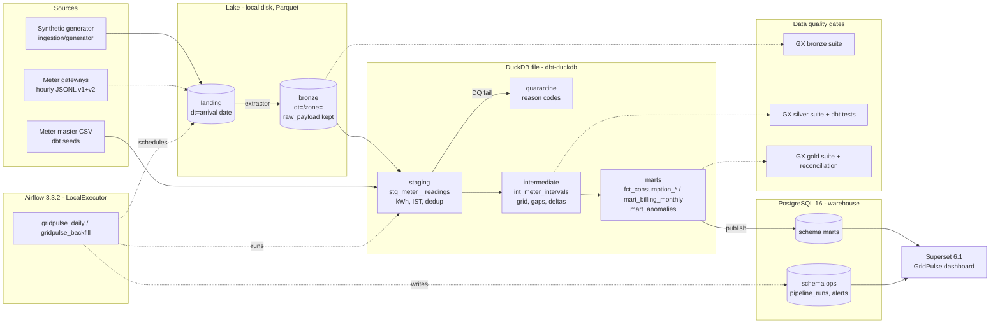

# GridPulse — Architecture (Phase 2)

Team 14 · Track B · Sprint 1 · Owner: Mahendra Umath (PO) · Author: Sagar Kalthiya
Decisions: [ADR-001](adr/ADR-001-orchestrator-and-runtime.md) runtime ·
[ADR-002](adr/ADR-002-drop-kafka-and-spark.md) LITE stack ·
[ADR-003](adr/ADR-003-partitioning-compaction-retention.md) partitioning/retention ·
[ADR-004](adr/ADR-004-late-data-handling.md) late data ·
[ADR-005](adr/ADR-005-schema-evolution.md) schema evolution.

## 1. Data flow

## 2. Layers

| Layer | Where | Grain | Written by | Key rule |
|---|---|---|---|---|
| Landing | `data/landing/dt=<arrival>/gw-<zone>-<YYYYMMDD>-<HH>.jsonl` | one line per event | gateways / generator | Read-only for the platform |
| Bronze | `data/lake/bronze/dt=/zone=/part-0.parquet` | one row per landed line | `ingestion/extractors/landing_to_bronze.py` | Append-only, `dt` replaced atomically (ADR-003) |
| Staging (silver) | DuckDB `staging` | one row per valid (`meter_id`, `reading_ts`) | dbt `stg_*` | kWh, IST, dedup, quarantine (ADR-005) |
| Intermediate (silver) | DuckDB `intermediate` | meter × 15-min grid | dbt `int_*` | Gaps marked, deltas from register, rollover |
| Marts (gold) | DuckDB `marts` → Postgres `warehouse.marts` | hour/day/month × meter/feeder/zone; anomaly events | dbt `fct_`/`mart_` + publish task | DECIMAL(18,4) kWh; reconciles to deltas |
| Ops | Postgres `warehouse.ops` | one row per run/alert | DAG callbacks | Lag p50/p95, dup rate, completeness, duration |

## 3. Orchestration

The daily DAG `gridpulse_daily` (US-15) is scheduled at 01:30 IST and processes logical date D. Tasks, in order:
1. `ingest_bronze` (landing `[D−3, D+1]`)
2. `gx_bronze`
3. `dbt_build_silver` (reading dates `[D−3, D]`)
4. `gx_silver`
5. `dbt_build_gold`
6. `gx_gold`
7. `publish_postgres`
8. `ops_metrics`
9. `alert_completeness`
10. `retention`

How it runs:
- Every task has 2 retries with a 2-minute delay.
- Tasks that touch DuckDB run in pool `duckdb` (1 slot), because DuckDB allows a single writer.
- `gridpulse_backfill` takes `start` / `end` params and runs the same task group per date (ADR-004).
- DAG files stay thin: they only call `ingestion/…` modules and `dbt` commands.

## 4. Deployment view (LITE profile, ADR-001/002)

| Service | Image | Host port | Memory limit |
|---|---|---|---|
| postgres | postgres:16.16 | 127.0.0.1:5433 | 1 GB |
| airflow-apiserver | gridpulse-airflow (apache/airflow:3.3.2 + `/opt/gridpulse-venv`) | 127.0.0.1:8080 | 1.5 GB |
| airflow-scheduler (runs tasks, LocalExecutor) | gridpulse-airflow | — | 3 GB |
| airflow-dag-processor | gridpulse-airflow | — | 1 GB |
| superset | gridpulse-superset (apache/superset:6.1.0) | 127.0.0.1:8088 | 1.5 GB |
| airflow-init / superset-init | one-shot | — | 1 GB / 1.5 GB |

Steady-state total is about 8 GB. Kafka and Spark are not deployed (ADR-002).

## 5. Measured sizing (7-day demo, 5,000 meters)

| Step | Result | Evidence |
|---|---|---|
| Generate | 3,392,136 lines, 1,023 files, 397 MB, **15 s** | `docs/evidence/sprint_1/generator_run.txt` |
| Landing → bronze (8 arrival dates) | 3,392,136 rows, 48 files, 38 MB, **38 s** | `docs/evidence/sprint_1/bronze_load_run1.txt` |
| Pruning: 1 day / 1 day + zone | 6/48 and 1/48 files scanned | `docs/evidence/sprint_1/bronze_checks.txt` |

## 6. Security
- Secrets live only in `.env`, which is git-ignored and gets random values from `make setup`.
- Superset connects as the read-only role `bi_reader` on `warehouse.marts` and `warehouse.ops`.
- All ports bind to 127.0.0.1.
- No customer PII is stored: meter IDs only.
