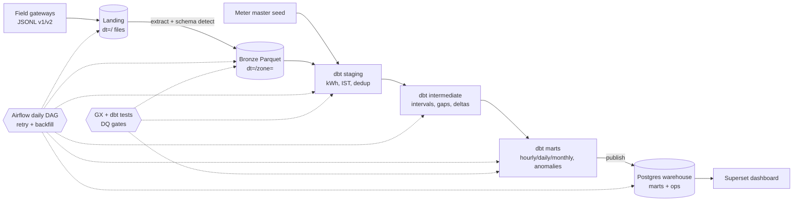

# GridPulse — Ideation Document

Team 14 · Track B · 27-Nov-2026 · Owner: Mahendra Umath (PO) · Author: Raja Rao Reddy

## Project summary (5 lines)
1. **Problem:** a power distribution utility receives smart-meter readings late, duplicated and in two changing formats.
2. **Users:** billing analysts, network operations engineers, revenue-protection team.
3. **Pain:** billing disputes, and tampering and outages found only after customers complain.
4. **Goal:** one trusted, normalised telemetry platform that produces billing-ready consumption and anomaly flags every day.
5. **Measure:** ≥ 90% completeness visible per zone, zero double-counted kWh, and anomalies flagged within one daily run.

## 1. Problem statement
| Aspect | Detail |
|---|---|
| Who is affected | Billing analysts (dispute handling), network ops (feeder load/outages), revenue protection (theft/tamper), and end consumers (wrong bills) |
| Current pain | Late and duplicated events inflate or deflate consumption. Mixed Wh/kWh units cause 1000× errors. Silent gap-filling hides missing data. Tamper and outages are detected only via complaints. |
| Cost of the problem | Disputed bills mean manual rework and delayed revenue. Undetected tamper means non-technical loss (revenue leakage). Late outage detection hurts SAIDI/SAIFI reliability indices and regulatory penalties. |
| Evidence from PRD | "Data arrives late, duplicated and in changing formats, so billing disputes are common and tampering or outages are found only after complaints." Schema v2 adds voltage and firmware, and some meters report kWh. |

## 2. Goals and success measures
| # | Goal | KPI / success measure |
|---|---|---|
| G1 | Trustworthy consumption | Aggregates reconcile to raw register deltas (difference = 0.0000 kWh). Duplicate rate after dedup = 0. |
| G2 | Billing-ready monthly table | 100% of active meters have a monthly row, with a completeness % and quality flag |
| G3 | Transparent data gaps | Completeness % per meter/day and per zone/day published. Days < 90% flagged. |
| G4 | Early anomaly detection | Spike, tamper and outage flags produced every daily run. Crafted test cases: 100% detected, 0 false positives on the control meters. |
| G5 | Reliable operations | Daily DAG succeeds with retries. Backfill for any date range. Run duration and ingest lag tracked. Alert when completeness drops. |
| G6 | Fast onboarding | `make demo` runs from a fresh clone to a live dashboard in < 15 min |

## 3. Solution options

### Option A — Batch file lakehouse (DuckDB + dbt + Postgres serving)
Gateways land JSONL files. An extractor writes bronze Parquet partitioned by `dt/zone`. dbt-duckdb builds staging, intermediate and marts. Marts are published to Postgres, and Superset reads them. Airflow runs daily, with backfill.
- **Pros:** fits the daily-batch PRD exactly. Lightest RAM use (fits 14 GB). Parquet partitioning, compaction and retention are explicit. dbt tests are native. Fast to build in 5 h.
- **Cons:** not real-time (ok, daily SLA). DuckDB is single-writer, so writes must be serialised.
- **Effort:** M · **Cost:** ₹0 (local OSS) · **Risk:** Low

### Option B — Streaming (Kafka → consumer → Postgres → dbt-postgres)
Gateways publish to Kafka topics per schema version. A consumer upserts into Postgres raw tables. dbt-postgres transforms. Superset reads.
- **Pros:** near-real-time outage detection. Kafka handles out-of-order arrival naturally with a DLQ.
- **Cons:** about 2 GB extra RAM (broker + UI). More moving parts. Postgres has to hold 43M raw rows and has no native columnar partitioning. The PRD does not require real-time.
- **Effort:** L · **Cost:** ₹0 local, high in prod · **Risk:** Medium (RAM, time)

### Option C — Spark lakehouse (Spark + Iceberg/Delta + Trino)
Spark Structured Streaming or batch writes Iceberg tables. Trino serves Superset.
- **Pros:** scales to millions of meters. ACID tables with time travel. Schema evolution built in.
- **Cons:** ~100 MB/day is far below Spark's break-even point (~10 GB/run). Cluster RAM exceeds the 14 GB host. Highest build effort, which doesn't fit 5 h.
- **Effort:** XL · **Cost:** high · **Risk:** High

## 4. Comparison matrix (score 1–5, higher = better)
| Criterion | Weight | A Batch lakehouse | B Streaming | C Spark lakehouse |
|---|---|---|---|---|
| Fit to PRD (daily runs, partitioning, retention, DQ) | 30% | 5 | 4 | 4 |
| Effort (fits 5 h, 1 builder) | 25% | 5 | 3 | 1 |
| Cost (infra + RAM) | 15% | 5 | 3 | 2 |
| Scalability | 15% | 3 | 4 | 5 |
| Risk | 15% | 5 | 3 | 2 |
| **Weighted total** | 100% | **4.70** | **3.45** | **2.80** |

(A = 0.30·5 + 0.25·5 + 0.15·5 + 0.15·3 + 0.15·5 = 4.70; B = 1.20 + 0.75 + 0.45 + 0.60 + 0.45 = 3.45; C = 1.20 + 0.25 + 0.30 + 0.75 + 0.30 = 2.80)

## 5. Chosen approach
**Option A — Batch file lakehouse.** It meets every must-have in the PRD: daily runs with retry and backfill, date/zone partitioning, compaction, retention and DQ gates. It is the only option that fits both the 14 GB host and the 5-hour budget.
- **Rejected B:** Kafka is optional in the PRD ("files or Kafka, team's choice"), and daily batch latency is acceptable. We can revisit it if network ops later need intraday outage alerts. The landing contract (JSONL per event) is Kafka-compatible.
- **Rejected C:** the volume does not justify Spark. Iceberg is a future option if scale grows 100×.

## 6. High-level solution sketch

**Main assumptions:** A1–A10 in [requirements.md](requirements.md#assumptions).
