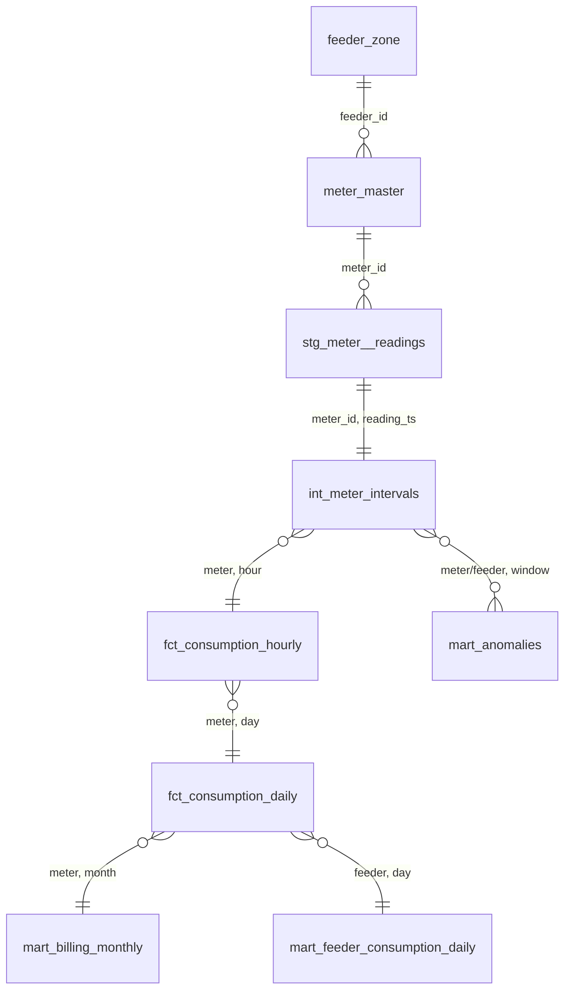

# GridPulse — Low-Level Design (Phase 3)

Team 14 · Track B · Sprint 1 · Author: Sagar Kalthiya · Reviewer: Mahendra Umath (PO)
Legend: ✅ implemented and verified · ⬜ designed, built in a later sprint (story in brackets).

## 1. Components

| # | Component | Repo path | Interface | Status |
|---|---|---|---|---|
| C1 | Synthetic generator | `ingestion/generator/` | `python -m ingestion.generator --days 7 [--meters --seed --end-date --out --seeds-dir]` | ✅ US-07 |
| C2 | Landing → bronze extractor + compaction | `ingestion/extractors/landing_to_bronze.py` | `python -m ingestion.extractors.landing_to_bronze --dt D \| --all \| --compact` | ✅ US-08 |
| C3 | Retention | `ingestion/extractors/retention.py` | `--raw-days 30 --hourly-months 13` | ⬜ US-15 |
| C4 | dbt project (staging → intermediate → marts) | `dbt_project/` | `dbt build --project-dir dbt_project --profiles-dir dbt_project` | ✅ staging, intervals, marts, anomalies (US-10…13) |
| C5 | GX checkpoints per layer | `data_quality/gx/run_checkpoint.py` | `--suite bronze\|silver\|gold` → exit ≠ 0 on failure | ⬜ US-14 |
| C6 | Publish DuckDB marts → Postgres | `ingestion/publish/to_postgres.py` | full refresh of the window, one transaction per table | ⬜ US-12 |
| C7 | Airflow DAGs | `airflow/dags/gridpulse_daily.py`, `gridpulse_backfill.py` | thin; call C2–C6 | ⬜ US-15 |
| C8 | Ops metrics + alerts | `ingestion/ops/metrics.py` | writes `ops.pipeline_runs`, `ops.alerts` | ⬜ US-19 |
| C9 | Superset dashboard as code | `superset/` | imported by `superset_init.sh` | ⬜ US-16 |

## 2. Data model

### 2.1 Entity relationships



### 2.2 Tables

**Bronze** (`data/lake/bronze/dt=/zone=/part-0.parquet`) ✅:

| Column | Type | Note |
|---|---|---|
| `raw_payload` | varchar | Exact landed line |
| `is_valid_json` | boolean | |
| `schema_version` | smallint | Explicit field, else 1 if `energy_wh` is present, else NULL |
| `meter_id` | varchar | NULL if the line is not valid JSON |
| `source_file` | varchar | `dt=…/gw-…jsonl` |
| `line_no` | int | Line number in the source file |
| `file_arrival_ts` | timestamptz | File mtime (gateway arrival) |
| `ingested_at` | timestamptz | Extractor run time |
| `dt`, `zone` | hive keys | Arrival date (IST) and gateway zone |

**Staging** ✅:
- `stg_meter__readings_validated` (table): every bronze row with `reject_reason` and `dup_rank`.
- `stg_meter__readings` (view): `reject_reason is null and dup_rank = 1`.
- `stg_meter__quarantine` (view): rows with a `reject_reason`.

| Column | Type | Rule |
|---|---|---|
| `meter_id`, `feeder_id`, `zone_id` | varchar | feeder and zone come from `meter_master` |
| `reading_ts` | timestamptz | Source timestamp snapped to the 15-min grid if within ±120 s |
| `interval_start_ts` | timestamptz | `reading_ts − 15 min` |
| `interval_date_ist` | date | IST date of `interval_start_ts`, the bucket key |
| `register_kwh` | decimal(18,4) | Wh × 0.001 or kWh as-is (exact decimal arithmetic) |
| `status` | varchar | OK / ROLLOVER / POWER_FAIL / ERROR |
| `voltage_v` | decimal(6,1) | v2 only |
| `firmware_version` | varchar | v2 only |
| `schema_version`, `snap_seconds` | smallint / bigint | |
| Lineage | | `source_file`, `line_no`, `file_arrival_ts`, `ingested_at`, `landing_date_ist` |

**Quarantine reason codes** (first rule that fails wins): `invalid_json` → `unknown_schema` → `missing_or_unparseable_field` → `unknown_unit` → `negative_energy` → `off_grid` → `unknown_meter`.

**`int_meter_intervals`** ✅ US-11. One row per meter per 15-min grid slot in the window. The date spine runs from `var('window_start')` to `var('window_end')`.

| Column | Type | Rule |
|---|---|---|
| `meter_id`, `feeder_id`, `zone_id` | varchar | |
| `interval_start_ts` | timestamptz | Grid slot |
| `interval_date_ist`, `interval_hour_ist` | date / timestamp | Bucket keys |
| `reading_ts` | timestamptz | NULL when the slot is a gap |
| `register_kwh` | decimal(18,4) | |
| `prev_register_kwh` | decimal(18,4) | Previous **received** reading |
| `is_gap` | boolean | No reading closes this slot |
| `gap_intervals` | int | Number of gap slots this delta spans (0 normally) |
| `delta_kwh` | decimal(18,4) | `register − prev`. If `status = ROLLOVER` and register < prev: `(register_max_kwh − prev) + register`. If register < prev otherwise: NULL with `dq_flag = 'register_decrease'`. For a gap slot: NULL, and the next received reading carries the whole delta once. |
| `dq_flag` | varchar | |

**Marts** ✅ built in DuckDB (US-12/13); Postgres publish ⬜ blocked (all kWh columns are `decimal(18,4)`, suffix `_kwh`):

| Model | Grain | Key columns | Published to Postgres |
|---|---|---|---|
| `fct_consumption_hourly` | meter × IST hour | `consumption_kwh`, `intervals_received`, `gap_intervals` | No (13-month lake, ADR-003) |
| `fct_consumption_daily` | meter × IST day | + `completeness_pct`, `quality_flag` (`LOW_COMPLETENESS` if < 87/96) | Yes |
| `mart_feeder_consumption_hourly` / `_daily` | feeder × hour/day | `consumption_kwh`, `meters_reporting` | Yes |
| `mart_zone_consumption_daily` | zone × day | `consumption_kwh` | Yes |
| `mart_billing_monthly` | meter × IST month | `billed_kwh`, `completeness_pct`, `gap_intervals`, `quality_flag` | Yes |
| `mart_anomalies` ✅ | one row per detected event (spike rule per ADR-006) | `anomaly_type` ∈ {SPIKE, TAMPER, OUTAGE}, `meter_id` (NULL for OUTAGE), `feeder_id`, `start_ts`, `end_ts`, `metric_value`, `threshold`, `affected_meters` | Yes |
| `mart_zone_completeness_daily` ✅ | zone × day | `completeness_pct`, `low_completeness_meter_days` | Yes |
| `mart_feeder_voltage_daily` | feeder × day | `min/avg/max_voltage_v`, `meters_reporting` | Yes (Could, US-21) |

### 2.3 Postgres DDL (serving, `warehouse` DB) ⬜ US-12/19

```sql
create schema if not exists marts;
create schema if not exists ops;

create table marts.mart_billing_monthly (
    billing_month_ist date          not null,  -- first day of IST month
    meter_id          varchar(16)   not null,
    feeder_id         varchar(8)    not null,
    zone_id           varchar(4)    not null,
    billed_kwh        decimal(18,4) not null,
    intervals_expected int          not null,
    intervals_received int          not null,
    gap_intervals     int           not null,
    completeness_pct  decimal(6,2)  not null,
    quality_flag      varchar(24),
    primary key (billing_month_ist, meter_id)
);

create table ops.pipeline_runs (
    run_id                text primary key,           -- Airflow run_id
    dag_id                text not null,
    logical_date_ist      date not null,
    started_ts            timestamptz not null,
    finished_ts           timestamptz,
    status                text not null,              -- success / failed
    bronze_rows           bigint,
    quarantined_rows      bigint,
    duplicate_rate_pct    decimal(6,3),
    completeness_pct      decimal(6,2),
    ingest_lag_p50_min    decimal(8,1),
    ingest_lag_p95_min    decimal(8,1),
    late_beyond_window_events bigint,
    duration_s            int
);

create table ops.alerts (
    alert_id     bigserial primary key,
    raised_ts    timestamptz not null default now(),
    run_id       text references ops.pipeline_runs(run_id),
    severity     text not null,                       -- WARNING / CRITICAL
    alert_type   text not null,                       -- completeness_drop / gx_failure / late_beyond_window
    scope        text not null,                       -- e.g. zone=Z04
    message      text not null
);
```

All other mart tables follow the same pattern: the grain columns form the primary key, `_kwh` columns are `decimal(18,4)`, and every table gets `grant select … to bi_reader`.

### 2.4 Source-to-target mapping

| Target | Source v1 | Source v2 | Transform |
|---|---|---|---|
| `meter_id` | `meter_id` | `meter_id` | As-is; must exist in `meter_master` |
| `reading_ts` | `ts` (offset or naive) | `ts` | Naive → `timezone('Asia/Kolkata', ts)`; snap to grid if within ±120 s |
| `register_kwh` | `energy_wh` | `energy` + `unit` | Wh × 0.001 / kWh; negative → quarantine |
| `status` | `status` | `status` | As-is |
| `voltage_v` | — | `voltage` | decimal(6,1) |
| `firmware_version` | — | `firmware_version` | As-is |
| `schema_version` | (inferred 1) | `schema_version` | As-is |
| `feeder_id`, `zone_id` | `meter_master` | `meter_master` | Join on `meter_id` |
| `consumption_kwh` (marts) | | | Σ `delta_kwh` by bucket of `interval_start_ts` in IST |

## 3. Interfaces

### 3.1 Landing file contract (gateway → platform) ✅
- **Path:** `data/landing/dt=<IST arrival date>/gw-<zone>-<YYYYMMDD>-<HH>[-rN].jsonl`.
- **Content:** UTF-8 JSON Lines, one event per line, unsorted. `-rN` marks a gateway re-send.
- **File mtime** = arrival time. It is used for ingest lag.
- **v1 event:** `{"meter_id":"MTR-00001","ts":"2026-11-20T10:15:00+05:30","energy_wh":1250300,"status":"OK"}`
- **v2 event:** `{"schema_version":2,"meter_id":"MTR-03001","ts":"…","energy":1250.3,"unit":"kWh","status":"OK","voltage":231.4,"firmware_version":"2.3.1"}`
- **Generator ground truth:** `data/landing/_manifest.json`, with stats per defect and the expected spike, tamper, outage, rollover, register_decrease and low_completeness cases.

### 3.2 Superset contract ⬜ US-16
- Superset reads only `warehouse.marts.*` and `warehouse.ops.*` as `bi_reader`.
- Datasets: `mart_feeder_consumption_daily`, `mart_anomalies`, `mart_zone_completeness_daily`, `ops.pipeline_runs`.
- Filters: `interval_date_ist`, `zone_id`, `feeder_id`.

### 3.3 Configuration
- **Environment variables only:**
  - `LANDING_ROOT`, `BRONZE_ROOT`, `DUCKDB_PATH`, `DUCKDB_THREADS`
  - `GEN_DAYS`, `GEN_METERS`, `GEN_SEED`, `GEN_END_DATE`… (see `ingestion/generator/config.py`)
  - Postgres credentials from `.env`
- **Anomaly and DQ thresholds** are dbt `vars` in `dbt_project.yml`, changed only via an ADR (CLAUDE.md).

## 4. Data-quality design

| Rule | Where | Mechanism | On failure |
|---|---|---|---|
| DQ-1 meter in master | staging ✅ | `unknown_meter` reason | Quarantine |
| DQ-2 energy ≥ 0 | staging ✅ | `negative_energy` reason | Quarantine |
| DQ-3 register monotonic unless ROLLOVER | `int_meter_intervals` ✅ | `dq_flag = register_decrease`, delta NULL | Row kept, excluded from sums, counted |
| DQ-4 completeness ≥ 90% (87/96) | `fct_consumption_daily` ✅, zone mart ✅ | `quality_flag = LOW_COMPLETENESS` | Flag + `ops.alerts` if a zone falls below 90% |
| Dedup key unique | staging ✅ | singular dbt test | dbt build fails |
| Layer gates | GX ⬜ | bronze / silver / gold checkpoints | Downstream tasks skipped, alert raised |
| Reconciliation | gold ✅ (singular dbt tests) | Σ hourly = Σ deltas per meter-day | Test fails |

**Verified in Sprint 1** (`docs/evidence/sprint_1/staging_vs_manifest.txt`):
- `bronze 3,392,136 = kept 3,347,177 + dups dropped 43,439 + quarantined 1,520`;
- every injected defect class is caught in exactly the expected count.

## 5. Anomaly rules (as implemented, Sprint 2)
| Type | Model | Rule (dbt vars) |
|---|---|---|
| SPIKE | `int_anomalies_spike_detected` | z > `spike_z_threshold` (3.0) vs trailing `spike_history_days` (30) with ≥ `spike_min_points` (96) clean intervals **and** kWh ≥ `spike_min_multiple` (8) × trailing mean (ADR-006). Consecutive intervals are merged into one event. |
| TAMPER | `int_anomalies_tamper_detected` | Register flat for ≥ `tamper_zero_intervals` (192) slots, while ≥ `tamper_peer_active_share` (70%) of the other meters on the feeder have kWh > 0 in that window. A zero delta that spans gaps counts every slot it covers. |
| OUTAGE | `int_anomalies_outage_detected` | ≥ `outage_missing_share` (30%) of the feeder's master meters are gaps in the same slot, for ≥ `outage_min_intervals` (2) consecutive slots. |

## 6. Known limitations (Sprint 2)
- Silver and gold are full rebuilds (about 60 s for 7 days). The 3-day incremental `delete+insert` (ADR-004) lands with the DAG (US-15).
- Publishing to Postgres (C6) and the Superset contract are not built yet: there is no Postgres on the build host (DEF-002).
- The Sprint 1 partial edge day is fixed: the grid window now starts at the first reading's IST date.
