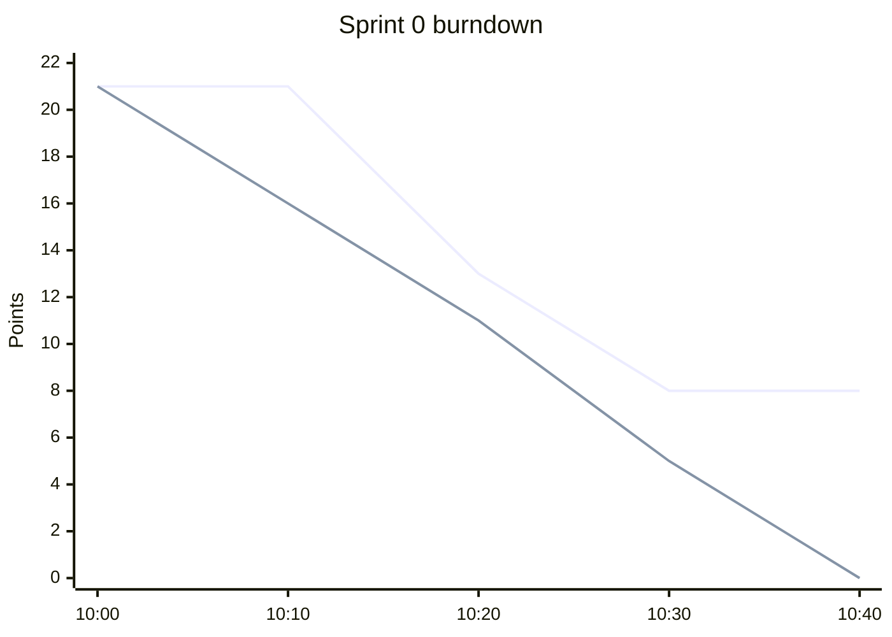

# Sprint 0: 27-Nov-2026 10:00 to 10:40 IST

**Sprint goal:** Requirements understood, ideation agreed, backlog in Excel, full stack running locally.
**Capacity:** 4.0 h (6 people × 40 min) **Committed:** 21 pts **Last velocity:** — (first sprint)

## Sprint backlog
| Story ID | Title | Pts | Owner | Status |
|----------|-------|-----|-------|--------|
| US-01 | Requirement analysis & ideation | 5 | Mahendra Umath | In review |
| US-02 | Backlog + release plan (md + xlsx) | 3 | Mahendra Umath | In review |
| US-03 | System check script | 2 | Raja Rao Reddy | In review |
| US-04 | Full stack in Docker Compose | 8 | Raja Rao Reddy | Blocked (DEF-002) |
| US-05 | Repo skeleton, Makefile, lint, pre-commit | 3 | Raja Rao Reddy | In review |

## Sprint board
| To do | In progress | In review | Done | Blocked |
|-------|-------------|-----------|------|---------|
| | | US-01, US-02, US-03, US-05 | | US-04 |

## Daily standup log
| Date | Done since last | Plan today | Blockers |
|------|-----------------|------------|----------|
| 27-Nov 10:00 | — (kick-off) | PRD analysis, backlog, CLAUDE.md, compose stack | Host port 5432 busy; another Airflow stack running |
| 27-Nov 10:25 | Requirements, ideation, RTM, backlog (22 stories/111 pts), xlsx export, compose + Dockerfiles, Makefile, lint/test green | Build images, `make up`, `make smoke` | Docker Desktop OOM-killed during build (DEF-002) |

## Burndown
| Time | Remaining pts | Ideal pts |
|-----|---------------|-----------|
| 10:00 | 21 | 21 |
| 10:10 | 21 | 16 |
| 10:20 | 13 | 11 |
| 10:30 | 8 | 5 |
| 10:40 | 8 | 0 |

(Points counted as burned when the story reaches In review with evidence; final acceptance at review.)

## Backlog refinement notes
- Stories split / re-estimated / re-prioritised: none (no story > 8 pts).
- product_backlog.xlsx re-exported: yes (`stories=22 points=111`).

## Sprint review
| Story ID | Demo evidence | Accepted? | Notes |
|----------|---------------|-----------|-------|
| US-01 | docs/ideation.md, docs/requirements.md, docs/rtm.md | pending PO | |
| US-02 | docs/scrum/product_backlog.md + .xlsx, evidence/sprint_0/export_backlog.txt | pending PO | |
| US-03 | evidence/sprint_0/system_check.txt | pending PO | Correctly flags the Docker daemon down |
| US-04 | compose + Dockerfiles written; dbt debug + GX pass locally | Not yet | Stack not started — DEF-002 |
| US-05 | `make lint`, `make test` (10 passed, 82%) | pending PO | |

**Completed:** pending PO review **Carried over:** US-04 if DEF-002 is not resolved

## Retrospective
- What went well: requirements to backlog fast; cached images reused; secrets generated automatically.
- What did not go well: an unbounded parallel image build pushed Docker Desktop into OOM.
- Action items (owner, due): build images sequentially and set Docker Desktop memory to 6 GB (Raja, before S1); add a free-RAM pre-check to `make up` (Raja, S1).
- Last sprint's action items, done?: n/a

## Impediments / RAID updates
| Type (R/A/I/D) | Description | Owner | Status |
|----------------|-------------|-------|--------|
| I | DEF-002 Docker Desktop OOM-killed (VM 8 GB on 14.8 GB host) | Raja Rao Reddy | Open |
| I | uv install script blocked → stdlib venv | Raja Rao Reddy | Resolved |
| I | No `gh` CLI → local squash merges; push needs PO OK | Raja Rao Reddy | Open |
