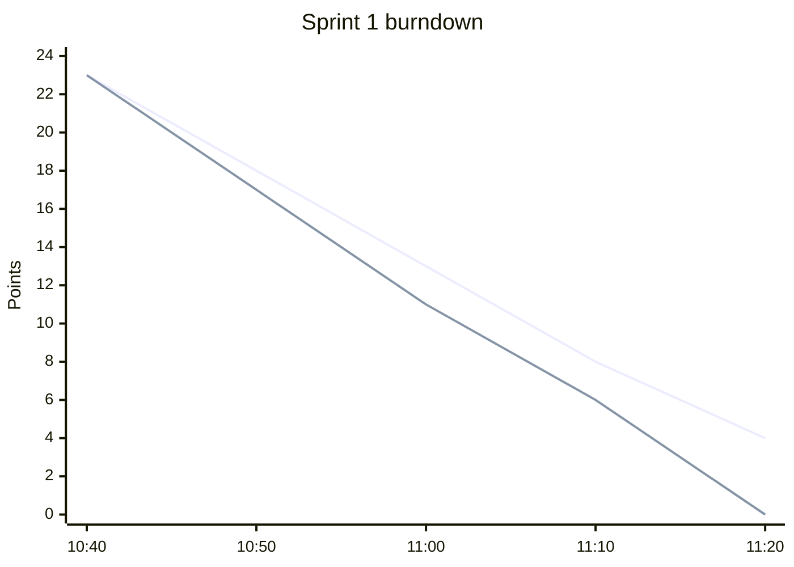

# Sprint 1: 27-Nov-2026 10:40 to 11:20 IST

**Sprint goal:** Architecture and LLD signed off; real data flowing landing → bronze → staging → first mart.
**Capacity:** 4.0 h (6 people × 40 min) **Committed:** 23 pts **Last velocity:** S0 pending PO review

Build machine changed this sprint. Sprint 0 ran on Raja's Ubuntu host; Sprint 1 runs on Sagar's Windows 11 laptop (16 GB RAM, Git Bash, Python 3.14 venv). This host has no `make` and no `docker` CLI on PATH, so all verification ran through the local venv on the same code paths the containers use.

## Sprint backlog
| Story ID | Title | Pts | Owner | Status |
|----------|-------|-----|-------|--------|
| US-06 | Architecture and ADRs | 5 | Mahendra Umath | In review |
| US-07 | Synthetic data generator with injected defects | 5 | Sagar Kalthiya | In review |
| US-08 | Bronze ingestion, both schema versions, compaction | 5 | Sagar Kalthiya | In review |
| US-09 | LLD, star schema DDL and walking skeleton | 8 | Mahendra Umath | Partial: LLD + local skeleton done; Postgres publish + Superset chart blocked (DEF-002) |

## Sprint board
| To do | In progress | In review | Done | Blocked |
|-------|-------------|-----------|------|---------|
| | | US-06, US-07, US-08 | | US-09 (AC2 only) |

## Daily standup log
| Date | Done since last | Plan today | Blockers |
|------|-----------------|------------|----------|
| 27-Nov 10:40 | S0 docs + skeleton committed (3d2a144) | Generator, bronze extractor, ADR-003/4/5, LLD, dbt staging | DEF-002 (Docker); S0 PO approval pending |
| 27-Nov 11:05 | US-07, US-08 committed with evidence; ADRs + architecture written | dbt staging + mart, LLD, sprint docs | No `make`/`docker` on this host |

## Burndown
| Time | Remaining pts | Ideal pts |
|-----|---------------|-----------|
| 10:40 | 23 | 23 |
| 10:50 | 18 | 17 |
| 11:00 | 13 | 11 |
| 11:10 | 8 | 6 |
| 11:20 | 4 | 0 |

Points count as burned when a story reaches In review with evidence. The remaining 4 points are US-09 AC2 (Postgres publish + Superset chart), which needs the Docker stack.

## Backlog refinement notes
- **US-10 (staging) pulled forward in part.** The walking skeleton needed it. It now does:
  - kWh conversion, IST parsing including naive timestamps, ±2 min grid snapping;
  - dedup and quarantine with reason codes, verified against the generator manifest.

  US-10 stays in S2 for its formal AC tests and the 3-day incremental window. Its estimate drops from 5 to 3 at the next refinement (PO to confirm).
- **US-14 (DQ) partly started.** Quarantine rules DQ-1 and DQ-2 are live in staging.

## Sprint review
| Story ID | Demo evidence | Accepted? | Notes |
|----------|---------------|-----------|-------|
| US-06 | docs/architecture.md, ADR-003/004/005, evidence/sprint_1/bronze_checks.txt (pruning 48 → 6 → 1 files) | Yes | AC1–AC3 met |
| US-07 | evidence/sprint_1/generator_run.txt; `tests/unit/test_generator.py` (determinism, defects, crafted anomalies) | Yes | 3,392,136 events in 15 s |
| US-08 | evidence/sprint_1/bronze_load_run1.txt, bronze_checks.txt; `tests/unit/test_landing_to_bronze.py` | Yes | Reconciles 1:1, idempotent, 1 file per partition |
| US-09 | docs/lld.md; evidence/sprint_1/dbt_build.txt (36/36), staging_vs_manifest.txt | Partial | AC1 met. AC2 local part met (landing → bronze → staging → mart). Postgres + Superset blocked by DEF-002 |

**Completed:** 19 of 23 pts accepted **Carried over:** US-09 AC2 (4 pts) to S2

**PO decision (27-Nov-2026):** APPROVED — relayed by Sagar Kalthiya in the build session on behalf of Mahendra Umath (PO).

## Retrospective
- **What went well:**
  - The generator's ground-truth manifest made staging verifiable to the exact row. Every injected defect class reconciles.
  - Bronze is 10× smaller than JSON, and partition pruning works as designed.
- **What did not go well:**
  - The build host changed mid-project. Git identity, `make` and Docker were missing on the new host.
  - Two test assertions double-counted events inside gateway re-sent files (DEF-003).
- **Action items (owner, due):**
  - Install GNU make + Docker Desktop on the Windows host, or move the build back to the Ubuntu host after DEF-002 is fixed (Sagar/Raja, before S2 publish work).
  - Push the stacked story branches and open PRs (Sagar, after PO OK).
- **Last sprint's action items, done?**
  - Build images sequentially / Docker 6 GB: not done (no Docker on this host).
  - Free-RAM pre-check: not done. Both carried over.

## Impediments / RAID updates
| Type (R/A/I/D) | Description | Owner | Status |
|----------------|-------------|-------|--------|
| I | DEF-002 Docker stack not running (Ubuntu host OOM; Windows host has no docker CLI on PATH) | Raja Rao Reddy / Sagar Kalthiya | Open |
| I | Windows host: no `make` → targets verified by running their underlying commands | Sagar Kalthiya | Open |
| D | Bronze partitioned by **arrival** date (ADR-003); silver/gold keyed by `interval_date_ist` | Mahendra Umath | Proposed |
| A | Partial edge day in completeness mart until the US-11 date spine | Shantanu Kale | Accepted for S1 |
