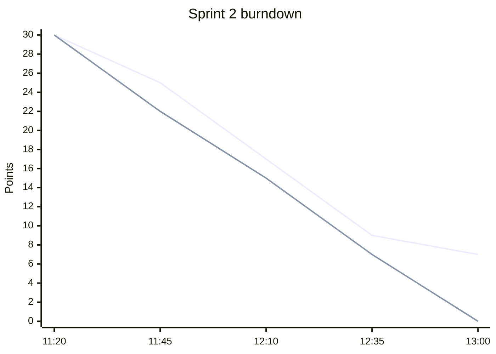

# Sprint 2: 27-Nov-2026 11:20 to 13:00 IST

**Sprint goal:** Normalised 15-min intervals, consumption marts and anomaly flags, all reconciled to the raw data.
**Capacity:** 10.0 h **Committed:** 26 pts (US-10…US-13), plus 4 pts carried from US-09 AC2 **Last velocity:** S1 19 pts

Host: Sagar's Windows 11 laptop (local venv, DuckDB). There is still no Docker or `make` here (DEF-002 / DEF-005), so anything that needs Postgres or Superset stays blocked.

## Sprint backlog
| Story ID | Title | Pts | Owner | Status |
|----------|-------|-----|-------|--------|
| US-10 | Staging: kWh, IST, dedup, ordering | 5 | Shantanu Kale | In review |
| US-11 | Interval grid, gaps and register deltas | 5 | Shantanu Kale | In review |
| US-12 | Consumption marts and publish to Postgres | 8 | Shantanu Kale | In progress: AC1 + AC2 met; AC3 (publish) blocked by DEF-002 |
| US-13 | Anomaly detection: spike, tamper, outage | 8 | Rituja Kekatpure | In review (ADR-006 accepted) |
| US-09 (carry) | Walking skeleton: Postgres + Superset leg | 4 | Mahendra Umath | Blocked (DEF-002) |

## Sprint board
| To do | In progress | In review | Done | Blocked |
|-------|-------------|-----------|------|---------|
| | US-12 (AC3) | US-10, US-11, US-13 | | US-09 AC2, US-12 AC3 |

## Daily standup log
| Date | Done since last | Plan today | Blockers |
|------|-----------------|------------|----------|
| 27-Nov 11:20 | S0 + S1 approved by PO; branches committed | US-11 grid, US-12 marts, US-13 anomalies, crafted tests | Push refused: `sagarkalthiya-sudo` has no write access to the repo (DEF-006) |
| 27-Nov 12:20 | US-11, US-12 (AC1/2) built and reconciled; spike rule measured | Anomalies, ADR-006, crafted-history tests | DEF-002 (no Postgres to publish to) |

## Burndown
| Time | Remaining pts | Ideal pts |
|-----|---------------|-----------|
| 11:20 | 30 | 30 |
| 11:45 | 25 | 22 |
| 12:10 | 17 | 15 |
| 12:35 | 9 | 7 |
| 13:00 | 7 | 0 |

The remaining 7 points are US-12 AC3 (publish, about 3 pts) and US-09 AC2 (4 pts). Both need the Docker stack.

## Backlog refinement notes
- **US-13: the spike rule as specified does not work.** Measured on the demo set, it flags 34,932 intervals on 4,998 of 5,000 meters.
  - Proposed fix in ADR-006: also require kWh ≥ 8 × the meter's trailing mean.
  - Result with the fix: 5/5 crafted spikes found, 0 false positives.
  - **ADR-006 accepted** (relayed by Sagar Kalthiya on behalf of Mahendra Umath (PO), 27-Nov-2026).
- **US-12 split (done 27-Nov-2026, PO):** AC3 (publish to Postgres, 3 pts) and the US-09 AC2 carry-over (4 pts) moved into the new story *US-23 Publish marts to Postgres and show them in Superset* (7 pts, S3).
- **New test harness:** `tests/integration/dbt_harness.py` runs the real pipeline on crafted histories. It feeds US-17 (test plan) in S3.

## Sprint review
| Story ID | Demo evidence | Accepted? | Notes |
|----------|---------------|-----------|-------|
| US-10 | evidence/sprint_2/pytest_dbt_crafted.txt (AC1–AC3 tests); sprint_1/staging_vs_manifest.txt | Yes | 1500 Wh = 1.5 kWh = 1500 Wh (v2) → 1.5000; triplicate → 1 kept, 2 counted; reversed files → no false decreases |
| US-11 | evidence/sprint_2/intervals_vs_manifest.txt; crafted tests | Yes | 3,360,000 grid rows; 3 gaps → gap_intervals = 3; ROLLOVER delta correct; register_decrease meters = manifest (3/3) |
| US-12 | evidence/sprint_2/dbt_build.txt (PASS=84) | Yes (AC3 moved to US-23) | Σ hourly = Σ staging deltas exactly; feeder = zone = billing = meter totals |
| US-13 | evidence/sprint_2/anomalies_vs_manifest.txt, spike_rule_measurement.txt; ADR-006 | Yes | 5/5 spike, 3/3 tamper, 1/1 outage, 0 false positives; negative controls silent |

**Completed:** 18 of 26 pts in review (US-10, US-11, US-13). US-12 is in progress (AC3 blocked). **Carried over:** US-12 AC3 + US-09 AC2.

## Retrospective
- **What went well:**
  - The ground-truth manifest plus crafted histories made every rule testable, including negative controls.
  - A mutation check proved the tests can fail.
  - Measuring the spike rule before shipping it caught a rule that would have flagged almost every meter.
- **What did not go well:**
  - The push to GitHub was refused (no collaborator access).
  - The Docker/Postgres blocker has now carried for two sprints.
  - One shell heredoc mishap cost a re-run.
- **Action items (owner, due):**
  - Raja to add `sagarkalthiya-sudo` as a collaborator with Write access (before S3).
  - Install Docker Desktop + GNU make on the Windows host, or run S3 publish/DAG work on the Ubuntu host (Sagar/Raja, start of S3).
  - PO decision on ADR-006 (Mahendra, S2 review): done, accepted.
- **Last sprint's action items, done?**
  - Push branches: blocked (DEF-006).
  - Docker/make: not done.

## Impediments / RAID updates
| Type (R/A/I/D) | Description | Owner | Status |
|----------------|-------------|-------|--------|
| I | DEF-002/005: no Docker stack on either host → no Postgres publish, no Superset | Raja Rao Reddy / Sagar Kalthiya | Open |
| I | DEF-006: push refused, `sagarkalthiya-sudo` lacks write access to `rajareddy-maker/manthan-w2-b-team14` | Raja Rao Reddy | Open |
| D | ADR-006 spike magnitude guard (8× trailing mean) | Mahendra Umath | Accepted |
| R | S3 holds DQ gates, DAG, dashboard and test plan, but the stack is still not running. Risk to the S3 goal. | Mahendra Umath | Open: escalate if Docker isn't up at S3 start |

**PO decision (Sprint 2 review):** APPROVED — relayed by Sagar Kalthiya on behalf of Mahendra Umath (PO), 27-Nov-2026. Accepted: US-10, US-11, US-12 (5 pts after split), US-13 = 23 pts.
